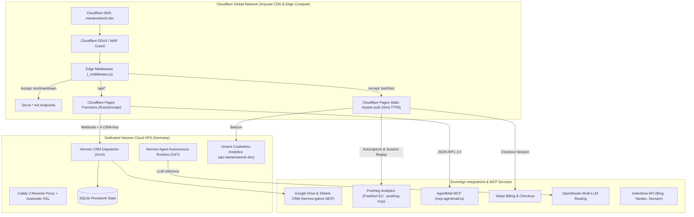

# AGENTS.md — marianstancik.dev (personal brand website)

Instructions for any coding agent (Jules, OpenCode, Hermes, Grok Bot, Claude, Codex, …). **Read the "Agent quick guide" first**; the detailed project reference follows below it.

## Agent quick guide

### Project

- **Purpose:** personal brand, blog and service catalogue of Marián Stančík (AI agent developer) at https://marianstancik.dev — also used as a live reference for clients.
- **Owner:** Marián Stančík, sole trader (operator details live in `site.config.json`). GitHub `Abra7abra7`.
- **Hosting:** Cloudflare Pages project `marian-stancik`, connected to this GitHub repo (every commit gets a "Cloudflare Pages" check, so PR branches get a preview deploy — open the link from the PR check). **There is no build step on Cloudflare**: generated pages are committed.
- **Backend status (2026-10-29):** the Hetzner VPS was reinstalled; `api.marianstancik.dev`, the CRM webhook and Umami analytics are **offline** until restored. Code paths that call them (`functions/api/subscribe.js` CRM sync, `functions/api/invoice/[id].js`, Umami beacon) may fail. TODO: confirm when/if they come back.

### Stack

- Static HTML + one CSS file (`css/main.css`) + vanilla JS (`js/i18n.js`, `js/three-bg.js`, `js/posthog.js`) — no framework, no bundler.
- Python 3 scripts in `scripts/` for build, i18n, verification and blog publishing (no `requirements.txt`; TODO: confirm third-party Python deps for scripts other than the build/check ones).
- Cloudflare Pages Functions in `functions/` (`_middleware.js`, `api/*`).
- `cloudflare/` is a separate Worker + D1 sub-project (`wrangler.toml`, own `package.json`); its `cloudflare/AGENTS.md` is outdated (still mentions Vercel). TODO: confirm whether that Worker is still deployed.

### Commands (all exist in `package.json` / `scripts/`)

```bash
git config core.hooksPath .githooks       # enable the pre-commit hook once per clone
python3 scripts/dev_server.py 8080        # local server with clean URLs   (npm run dev)
python3 scripts/build_i18n.py             # regenerate /en /sk /cs /de /pl pages + js/i18n.js   (npm run build)
python3 scripts/build_i18n.py --check     # fails if generated pages are stale
python3 scripts/check_i18n.py             # hreflang, canonical, internal links, sitemap   (npm run check:i18n)
python3 scripts/verify_site.py            # full verification suite   (npm run verify)
node --check js/i18n.js && node --check js/three-bg.js
```

- `verify_site.py` and the pre-commit hook also call the **live** `/api/subscribe` endpoint (network required; a Cloudflare challenge is reported as a warning).
- **Never run `npm run deploy`** — it deploys straight to production (`wrangler pages deploy … --branch=main`). Production changes happen only by merging an approved PR.

### Structure

```
index.html, about.html, skills.html, drones.html, expertise.html, contact.html, services.html, services-sk.html, blog/index.html
                         # EN source templates (root URLs 301 → /en/… via _redirects)
en/ sk/ cs/ de/ pl/      # GENERATED by scripts/build_i18n.py — do not hand-edit, rebuild instead
locales/ui/{en,sk,cs,de,pl}.json   # source of truth for UI strings (flat keys = element id / data-i18n)
locales/*.json           # older 4-language dictionaries used by js/i18n.js
blog/posts/              # posts: /blog/posts/{slug} and /blog/posts/{lang}/{slug}, each .html + .md
functions/               # Cloudflare Pages Functions (edge API + markdown content negotiation)
scripts/                 # build, i18n, verify, publish_post.py, reports
docs/legal/              # legal drafts (Slovak) — change only with approval
site.config.json         # central config: profile, operator, products, Stripe links
_headers, _redirects, robots.txt, sitemap.xml, llms.txt, llms-full.txt, rss.xml
.agents/skills/          # task skills (see section 3 below)
```

### Conventions

- **Languages:** EN (default, `x-default`), SK, CS, DE, PL. Edit EN templates + `locales/ui/*.json`, then run `build_i18n.py` and commit the generated files together with the source change. Products page exists only in EN and SK.
- Every HTML page/post has a Markdown twin (`*.md`) for AI crawlers — keep them in sync.
- Brand name in code, file names and metadata: **"Marian Stancik"** (no diacritics); legal/operator texts use the legal name from `site.config.json`.
- Single design system in `css/main.css` — no page-level `<style>` blocks.
- Blog posts are published by Hermes with `scripts/publish_post.py --langs sk,en,cs,de,pl --pr` (always a PR, never a push to `main`).
- Prices, Stripe links and legal texts change only on explicit request.

### Working rules (mandatory for every agent: Jules, OpenCode, Hermes, Grok Bot, Claude, Codex, …)

- **Branch + Pull Request only.** Create a feature branch (`feat/…`, `fix/…`, `docs/…`, `seo/…`), open a PR and wait for review. **Never push or force-push to `main`/the default branch** and never merge your own PR.
- **No secrets in git.** Never commit `.env*`, API keys, tokens, passwords, private keys, server IP addresses, SSH details or personal data. Use the hosting platform's environment variables; reference variables by **name only**. If you find a secret in the repo, stop and report it — do not copy it anywhere.
- **GDPR / privacy first.** Treat any personal data (leads, customers, patients, form submissions) as confidential. No new trackers, cookies, analytics, third-party scripts or data processors without explicit approval; keep privacy/cookie pages consistent with what the code actually does.
- **The client owns the domain, the content and the data.** Do not change DNS, domains, hosting settings, payment settings, legal texts or published client content without explicit approval.
- **No destructive changes without approval.** No deleting pages/data/files in bulk, no history rewrites, no dependency major-version upgrades, no production deploys, no outgoing emails/posts from tests.
- **Invent nothing.** If a fact (price, company detail, legal statement, metric) is not in the repo or the task, leave a `TODO: confirm` instead of guessing.
- **Small, focused diffs.** Reuse existing patterns and dependencies; do not add a new dependency if an existing one covers the need.

### Definition of Done

1. All checks listed under *Commands* that exist for this repo pass locally (build, tests, lint/verification).
2. The **preview deploy** of the PR branch was opened and checked (desktop + mobile) — or, if this repo has no preview, the reason is stated in the PR.
3. The PR description contains: a short summary of *what* and *why*, the list of changed areas, how it was tested, the preview URL, and any `TODO: confirm` items or risks.
4. Nothing goes live until Marián approves (**ÁNO**) and merges the PR.

---

# Project reference (detailed notes)

# marian-stancik-web — Personal Brand Website & Autonomous Engineering Hub

**Owner:** Marian Stancik  
**Version:** `v1.3.0` (Production Release — Unified Midnight Navy, Clean URLs & Consolidated Design System)  
**Domain:** https://marianstancik.dev (Production on Cloudflare Pages)  
**Apex & WWW Support:** https://marianstancik.dev & https://www.marianstancik.dev  
**Cloudflare Pages Project:** `marian-stancik` (`marian-stancik.pages.dev`)  
**Repo:** https://github.com/Abra7abra7/marian_stancik_dev_web  
**Backend VPS:** Hetzner Cloud behind `api.marianstancik.dev` (Caddy + Python WSGI + Hermes Agent + Umami). IP address intentionally not stored in this public repo. **Offline since the 2026-10-29 reinstall — see the Agent quick guide.**  
**Default Branch:** `main` (production — changes land only through reviewed and approved Pull Requests)

---

## 1. Executive Overview & Mission

This repository represents the official personal brand website, technical knowledge graph, showcase reference architecture, and autonomous agent hub for **Marian Stancik** — AI Agent Developer & Autonomous Systems Builder.

The platform serves both as Marian's personal brand and as a **live production showcase for clients**, demonstrating how modern web engineering, autonomous AI agents, regulatory compliance (Legal-by-Design), and sovereign infrastructure integrate seamlessly without costly SaaS overhead.

The platform operates across three foundational pillars:
1. **AI Engineering & Autonomous Multi-Agent Systems:** 24/7 Hermes Agent orchestration, custom Model Context Protocol (MCP) servers (Google Drive, PostHog, OpenSEO, AgentMail), OpenRouter multi-LLM dynamic routing, and an Obsidian persistent memory layer running on dedicated European Hetzner Cloud infrastructure.
2. **Law, EU AI Act & Regulatory Governance (Legal-by-Design):** Practical compliance architectures covering the EU AI Act (risk tiering, GPAI, technical files, Art. 50 disclosure), GDPR (Art. 7(3) opt-out), NIS2 Directive, DORA, EU Data Act, and statutory consumer protection (Act No. 108/2024 Coll. & Act No. 452/2021 Coll.).
3. **Tactical UAV Systems & Edge Robotics (Hobby Project):** Hand-soldered carbon quadcopter, ArduPilot Copter autopilot, Raspberry Pi 5 onboard companion computer with real-time edge vision AI, certified EASA A1/A3 with €2.6M Coverdrone insurance.

---

## 2. Brand Identity & Quality Standards

### Name & Visual Identity
- **Name Standard:** Always **Marian Stancik** (strictly without diacritics in code, filenames, schemas, and English/Slovak metadata).
- **Professional Title:** **AI Agent Developer & Autonomous Systems Builder** (studying law, building sovereign multi-agent architectures).
- **Social / OG Image Standard:** All pages and articles use Marian's photo (`https://www.marianstancik.dev/profile-big.webp` or `profile.webp`) as `og:image` and `twitter:image` with `width="800" height="800"` and `alt="Marian Stancik"`.
- **Search Snippet & Favicon Standard:** Circular portrait favicon with high-contrast bronze ring border generated from `profile.webp` across standard resolutions (`favicon.ico`, `favicon-32x32.png`, `favicon-48x48.png`, `apple-touch-icon.png`).
- **Design Tokens & Visual Architecture:**
  - **Celestial Midnight Navy Theme:** Single consolidated source of truth in `css/main.css` (`--color-bg: #0A111C;`, `--color-bg-deep: #060B12;`, `--color-bg-secondary: #080E18;`, `--color-bg-card: rgba(14, 25, 42, 0.72);`, `--color-bg-card-hover: rgba(22, 38, 62, 0.88);`, `--color-primary: #CD7F32;`, `--color-accent: #EBC37D;`).
  - **Seamless Fixed Background:** `radial-gradient(ellipse 90% 55% at 50% 0%, #122238 0%, #0A111C 45%, #060B12 100%) no-repeat fixed;` on `body` eliminating horizontal color seams and banding across all sections and subpages.
  - **Three.js Layer:** Transparent background canvas (`alpha: true`) allowing the global celestial gradient to shine through seamlessly.
  - **Zero Duplicate Styles:** Zero page-level `<style>` overrides across `index.html`, `services.html`, `about.html`, and `blog/index.html`. Single DRY CSS architecture.

---

## 3. Autonomous Skill Routing & Execution (.agents/skills)

The repository provides 26 specialized skills under `.agents/skills/`. Autonomous agents MUST load and follow the corresponding skill when encountering matching tasks:

### Frontend, UI Polish & WebGL
- When building UI components, hover effects, stagger animations, transitions, or optical alignment, read `.agents/skills/better-ui/SKILL.md` and follow it.
- When inspecting existing page layouts, auditing visual hierarchy, or improving page aesthetics, read `.agents/skills/improve-ui/SKILL.md` and follow it.
- When generating new landing pages, semantic sections, or standalone HTML templates, read `.agents/skills/html-generator/SKILL.md` and follow it.
- When modifying, optimizing, or debugging Three.js celestial background, shaders, or 3D canvas, read `.agents/skills/webgl-components/SKILL.md` and follow it.

### Code Quality, Design & Performance
- When reviewing pull requests, inspecting git diffs, or auditing code quality, read `.agents/skills/code-review/SKILL.md` and follow it.
- When designing new modules, organizing functions, or establishing architectural boundaries, read `.agents/skills/codebase-design/SKILL.md` and follow it.
- When profiling frontend performance, measuring execution time, or auditing asset load speed, read `.agents/skills/metronome/SKILL.md` and follow it.

### SEO, Keywords, Discovery & Reporting
- When conducting technical on-page SEO audits, schema markup verification, or crawlability checks, read `.agents/skills/seo-audit/SKILL.md` and follow it.
- When generating client-facing or internal SEO audit reports, scorecards, or recommendations, read `.agents/skills/seo-report/SKILL.md` and follow it.
- When providing strategic search advice, algorithm update adaptations, or content guidance, read `.agents/skills/seo-coach/SKILL.md` and follow it.
- When setting up new SEO tracking, Search Console indexing, or initial crawl configurations, read `.agents/skills/seo-project-setup/SKILL.md` and follow it.
- When conducting keyword discovery, search intent mapping, or query volume evaluations, read `.agents/skills/keyword-research/SKILL.md` and follow it.
- When grouping keywords into semantic topic clusters for blog posts or service landing pages, read `.agents/skills/keyword-clustering/SKILL.md` and follow it.
- When optimizing local business visibility, Google Business Profile schema, or localized pages, read `.agents/skills/local-seo/SKILL.md` and follow it.
- When discovering backlink opportunities, domain authority outreach, or link profile prospecting, read `.agents/skills/link-prospecting/SKILL.md` and follow it.

### Market & Competitor Intelligence
- When benchmarking competitor service offerings, pricing structures, or feature matrices, read `.agents/skills/competitor-analysis/SKILL.md` and follow it.
- When mapping industry competitive landscape, value propositions, or market positioning, read `.agents/skills/competitive-landscape/SKILL.md` and follow it.

### Stripe Billing, Payments & Connect
- When designing Stripe checkout flows, webhook event handling, or tax and currency logic, read `.agents/skills/stripe-best-practices/SKILL.md` and follow it.
- When referencing Stripe API endpoints, parameter payloads, webhooks, or SDK methods, read `.agents/skills/stripe-docs/SKILL.md` and follow it.
- When creating, verifying, or testing Stripe Checkout session links, payment links, or customer receipts, read `.agents/skills/stripe-pay/SKILL.md` and follow it.
- When scoping multi-tier subscription plans, invoicing structures, or SaaS billing retainers, read `.agents/skills/stripe-projects/SKILL.md` and follow it.
- When developing custom Stripe Dashboard applications or merchant UI extensions, read `.agents/skills/stripe-apps/SKILL.md` and follow it.
- When structuring Stripe account assets, webhook secret hierarchies, or API key configurations, read `.agents/skills/stripe-directory/SKILL.md` and follow it.
- When upgrading Stripe API versions, SDK packages, or migrating payment elements, read `.agents/skills/upgrade-stripe/SKILL.md` and follow it.
- When selecting Stripe Connect account architectures (Standard, Express, Custom) for platform payouts, read `.agents/skills/connect-recommend/SKILL.md` and follow it.
- When validating KYC, identity verification documents, and AML compliance for Stripe Connect onboarding, read `.agents/skills/connect-required-verification-information/SKILL.md` and follow it.

---

## 4. Infrastructure & Hosting Architecture (Cloudflare + Hetzner Hybrid)



### Hosting Environments & Active Endpoints
1. **Frontend & Edge Hosting (Cloudflare Pages):**
   * **Project Name:** `marian-stancik` (`marian-stancik.pages.dev`).
   * **Custom Domains:** `marianstancik.dev` (Apex) and `www.marianstancik.dev` (CNAME), with full Google Trust Services SSL encryption.
   * **Sub-15ms TTFB:** Vienna (`VIE`) and Frankfurt (`FRA`) edge datacenters with 0ms Total Blocking Time (TBT).
   * **Security Headers:** Strict CSP, HSTS preload, Permissions-Policy, Cache-Control via `_headers`.
   * **Redirects:** Managed via `_redirects` (`/subscribe -> /#leadForm`).
2. **Serverless Edge Functions (Cloudflare Pages Functions):**
   * Located in `functions/api/`:
     * `functions/api/subscribe.js`: Lead capture, honeypot protection, customer confirmation dispatch, admin alert, CRM webhook sync.
     * `functions/api/crm-email.js`: Direct CRM email webhook dispatcher with `x-crm-key` token guard.
     * `functions/api/invoice/[id].js`: Secure HTTPS proxy to backend VPS with `noindex, no-store` headers.
     * `functions/api/email-templates.js`: Branded HTML email templates with GDPR Art. 7(3) and § 116 Act No. 452/2021 Coll. unsubscribe link.
   * Located in `functions/_middleware.js`:
     * Intercepts `Accept: text/markdown` from AI crawlers and routes directly to clean `.md` alternates.
3. **Backend VPS (Hetzner Cloud — Germany):**
   * **Hostname:** `api.marianstancik.dev` (proxied through Cloudflare; the origin IP is kept out of the public repo).
   * **Caddy 2 Reverse Proxy:** Reverse proxies internal services, handles SSL termination via Let's Encrypt / ZeroSSL.
   * **Hermes Agent Runtime:** Background autonomous loops handling content publishing, social syndication, sentinel monitoring, and CRM sync.
   * **Hermes CRM Dispatcher:** Receives webhooks at `https://api.marianstancik.dev/crm/`, syncs leads to SQLite and Google Sheets.
   * **Umami Analytics:** Self-hosted cookieless European instance at `https://api.marianstancik.dev/script.js` (Website ID: `ec1c0df8-e51f-4236-9ad0-e3992f0b1637`).

---

## 5. Comprehensive Services & External Integrations Matrix

| Service / Tool | Role / Purpose | Protocol / Auth | Hosting / Region | Status |
| :--- | :--- | :--- | :--- | :--- |
| **Cloudflare Pages** | Static asset delivery, Edge CDN, caching | HTTPS / Edge Cache | Global Anycast (VIE/FRA) | ✅ Active (Production) |
| **Cloudflare Functions** | Serverless API backend (`/api/subscribe`, `/api/crm-email`) | Edge V8 Workers | Global Anycast | ✅ Active |
| **Hetzner Cloud VPS** | 24/7 Hermes runtime, CRM service, Umami analytics | HTTPS / SSH / Caddy | Germany (Nuremberg) | ✅ Active |
| **Google Drive & Sheets CRM** | Double-entry sovereign CRM for leads & client folders | Google Service Account / Sheets API v4 | Sovereign Google Drive | ✅ Active (`hermes-gdrive` MCP) |
| **PostHog Analytics** | Session replays, heatmaps, autocapture & funnel metrics | JavaScript SDK + REST API | Germany (Frankfurt EU Cloud) | ✅ Active (`posthog-mcp`) |
| **AgentMail MCP** | Transactional & notification email sending without SMTP | JSON-RPC 2.0 (`mcp.agentmail.to`) | Cloud API (`x-api-key`) | ✅ Active |
| **Stripe** | Payment processing for 4 audits & 3 subscriptions | Stripe Checkout Links | Global / EU compliant | ✅ Active |
| **OpenRouter** | Multi-LLM dynamic routing (DeepSeek, Claude 3.5, GPT-4o) | REST API (`Bearer ${key}`) | US/EU multi-provider | ✅ Active |
| **Umami Analytics** | Cookieless GDPR-compliant traffic analytics | Lightweight JS Beacon | Hetzner VPS (`api.marianstancik.dev`) | ✅ Active |
| **OpenSEO MCP** | Automated SEO audits, keyword research, gap analysis | MCP JSON-RPC (`app.openseo.so`) | Cloud MCP Server | ✅ Active |
| **IndexNow** | Instant search index pinging (Bing, Yandex, Seznam) | REST HTTP POST | Search engine endpoints | ✅ Active |

### Obsolete / Removed Services (Archived)
- ❌ **Vercel:** Fully decommissioned. The entire site and DNS are hosted on Cloudflare Pages and Hetzner VPS.
- ❌ **Subdomains `app.marianstancik.dev` & `hpi.marianstancik.dev`:** Removed from Cloudflare DNS.
- ❌ **Google Cloud project `pc-work-gemini-cli`:** Deleted in Google Cloud Console; active project is `hermes-agent-desktop-pc-work`.
- ❌ **Delta Defence / Defence Product Manager:** Removed. All personal and professional branding is focused on AI Agent Development, Legal-by-Design, and UAV Robotics.

---

## 6. What the Website Does & Core Features

1. **Autonomous Personal Brand & Client Reference Showroom:** Demonstrates a production-grade, sovereign stack operating without bloated monthly subscriptions.
2. **Product Catalog & Instant Stripe Checkout:**
   * **4 One-Time Audits & Builds:**
     * *AI GEO Audit* (€199): 48h evaluation of AI search visibility (llms.txt, JSON-LD, robots.txt, Perplexity/ChatGPT presence).
     * *AI Web Readiness Scan* (€200): Technical compliance check covering GDPR Privacy Policy, consent, Terms, AI Act disclosures.
     * *Full Web Audit* (€300): Combined GEO + Readiness scan with 30-min strategy call.
     * *Custom Autonomous AI Agent* (From €500 deposit): Custom 24/7 autonomous agent system on dedicated VPS with MCP tooling.
   * **3 Monthly Recurring Subscriptions:**
     * *GEO Monitoring Weekly* (€49/mo): Automated weekly scans & alert reports.
     * *Sentinel Agent 24/7* (€99/mo): Continuous uptime, security & crawler monitor.
     * *Autonomous Ops Retainer* (€249/mo): Managed agent operations & custom tool extensions.
3. **Autonomous Multilingual Technical Blog:**
   * 20 in-depth technical essays on production agent infrastructure, enterprise AgenticOps, MCP, and AI governance.
   * Multi-language parity: 80 synchronized articles (all 20 available in `EN`, `SK`, `DE`, `PL` both as `.html` and `.md`).
   * Interactive inline newsletter subscription card right inside each post with instant AJAX feedback.
4. **Lead Capture & Customer Onboarding:**
   * High-conversion homepage form + in-article forms submitting to `/api/subscribe`.
   * Automated double-send: instant branded HTML confirmation to client + instant alert to Marian.
   * Real-time sync into Google Sheets CRM (`1mcVQxHMu1SavnoJussw9KCpleT-qhFs8FJMe4F8h5PM`) and Hetzner SQLite.

---

## 7. Centralized Configuration & 4-Language i18n Matrix (`EN`, `SK`, `DE`, `PL`)

All site metadata, product definitions, Stripe pricing, social handles, and multilingual dictionaries are managed centrally:

```
├── site.config.json            # Central Single Source of Truth
├── locales/
│   ├── en.json                 # English (Primary International)
│   ├── sk.json                 # Slovak (Native Domestic)
│   ├── de.json                 # German (DACH Market)
│   └── pl.json                 # Polish (CEE Market)
└── js/i18n.js                  # Zero-build High-Performance i18n Client Engine
```

### i18n Routing & DOM Conventions
1. **Dynamic DOM Translation:** Any element with `id="KEY"` or `data-i18n="KEY"` automatically receives translated text or HTML from `locales/*.json` via `js/i18n.js`.
2. **Intelligent URL Subpage Router:**
   * When on `/services` and clicking `SK` → automatically navigates to `/services-sk`.
   * When on `/services-sk` and clicking `EN`, `DE`, or `PL` → automatically navigates to `/services`.
   * Similarly for paired legal subpages: `/privacy` <-> `/privacy-sk`, `/terms` <-> `/terms-sk`, `/disclaimer` <-> `/disclaimer-sk`.
   * In blog articles: clicking language buttons routes cleanly between `/blog/posts/{slug}`, `/blog/posts/sk/{slug}`, `/blog/posts/de/{slug}`, and `/blog/posts/pl/{slug}`.
3. **Dynamic Navigation Link Rewriting:**
   * When `currentLang === 'sk'`, navigation links (`#navProducts`, `#navServices`, `.home-prod-card`) dynamically point to `/services-sk`.
   * When `currentLang !== 'sk'`, they point to `/services`.
4. **Client-Side Event Bus:** Language switching triggers a `languageChanged` custom DOM event and stores preference in `localStorage.getItem('ms_lang')`.

---

## 8. Generative Engine Optimization (GEO) & AI Discovery (LLMO)

To guarantee instant, authoritative discovery and citations across AI engines (**Perplexity, ChatGPT Search, Claude, Google SGE, Grok**) as well as standard search engines:

1. **100/100 Core Web Vitals:** Mobile & Desktop performance (sub-15ms TTFB, LCP < 400ms, CLS = 0). Zero render-blocking resources, externalized minified CSS/JS, and asynchronous Three.js canvas.
2. **`llms.txt` & `llms-full.txt` (llmstxt.org v2 Standard):** Clean Markdown links with summaries of all articles, products, and pages.
3. **4-Language Markdown Alternates & Content Negotiation:** Every HTML page and blog post provides a clean markdown version (`*.md`). `functions/_middleware.js` intercepts requests with `Accept: text/markdown` and transparently routes AI agents directly to `.md` endpoints (`Vary: Accept`).
4. **AI Crawler White-Listing & Content-Signals (`robots.txt`):** Explicitly grants access to GPTBot, ChatGPT-User, ClaudeBot, PerplexityBot, Google-Extended, Applebot-Extended, CCBot, Bravebot, Meta-ExternalAgent, Cohere-ai, Diffbot, and OAI-SearchBot while defining modern content licensing signals:
   ```text
   Content-Signal: ai-train=no, search=yes, ai-input=yes
   ```
5. **Schema.org JSON-LD Hierarchy:** Rich `@graph` containing `Person`, `Organization`, `WebSite`, `Service`, `Offer`, and `FAQPage` schemas with precise pricing (€199, €200, €300, €500).

---

## 9. Lead Capture, Newsletter Lifecycle & Legal Compliance

```mermaid
flowchart LR
    Visitor[Client Web Form] -->|POST /api/subscribe| EdgeFunction[Cloudflare Pages Function]
    EdgeFunction -->|Honeypot Check| SpamDrop[Silently drop bots]
    EdgeFunction -->|JSON-RPC 2.0| AgentMail[mcp.agentmail.to]
    AgentMail -->|Branded HTML + Unsubscribe| CustomerInbox[Customer Inbox]
    AgentMail -->|Instant Alert| MarianInbox[marianstancik@agentmail.to]
    EdgeFunction -->|POST /crm/ Webhook| HetznerCRM[api.marianstancik.dev]
    HetznerCRM -->|Storage| Sheets[(Google Sheets CRM)]
    EdgeFunction -.->|Failover Alert| DownAlert["[CRM DOWN] Alert Email"]
```

### Statutory Compliance & Consumer Protection
1. **Statutory Digital Content Waiver (§ 19 Act No. 108/2024 Coll.):**
   * Before redirecting to Stripe, clients purchasing digital audits must confirm:
     > *"I explicitly consent to the commencement of digital service provision before the expiry of the statutory 14-day withdrawal period, and I acknowledge that by granting this consent, I lose the right of withdrawal under § 19 of Act No. 108/2024 Coll. once the service is fully provided."*
2. **Statutory Unsubscribe & Consent Withdrawal (GDPR Art. 7(3) & § 116 Act No. 452/2021 Coll.):**
   * Every outgoing email generated by `functions/api/email-templates.js` contains full sender identification (Marián Stančík, IČO: 57068917, DIČ: 1082585075), Art. 50 AI disclosure, and a direct, free, one-click opt-out link:
     > *"Tento e-mail ste dostali na základe udeleného súhlasu na marianstancik.dev. Odber môžete kedykoľvek bezplatne zrušiť: [Odhlásiť sa z odberu](mailto:marianstancik@agentmail.to?subject=Unsubscribe%20Newsletter)."*
3. **Cookieless EU Privacy Architecture:**
   * 100% cookieless analytics via self-hosted Umami on European infrastructure (`api.marianstancik.dev`).
   * Zero third-party cookies, no tracking pixels, fully compliant with GDPR Art. 6(1)(f) and the ePrivacy Directive without intrusive cookie consent banners.

---

## 10. Automated Verification Suite (`scripts/verify_site.py`)

Run the 9-tier verification script before any deployment:
```bash
python scripts/verify_site.py
```

### Test Tiers
1. **Tier 1 — Security & Quality Sweep:** Scan ensuring clean metadata and zero unauthorized secrets.
2. **Tier 2 — JS Syntax Check (L0):** `node --check js/i18n.js` and `node --check js/three-bg.js`.
3. **Tier 3 — HTML Meta & Link Integrity:** Validates root-relative links, OpenGraph tags, and JSON-LD syntax across all pages.
4. **Tier 4 — Design Tokens & CSS Validation:** Checks `:root` token presence in `css/main.css`.
5. **Tier 5 — AI Discovery & GEO:** Validates `<link rel="alternate" href="/llms.txt">` and AI crawler permissions in `robots.txt`.
6. **Tier 6 — API Health Check (L8):** Validates live HTTP 200 response from `/api/subscribe`.
7. **Tier 7 — Config, Locales & Markdown Integrity:** Validates `site.config.json`, all 4 `locales/*.json` files, and guarantees 80/80 `.html` and `.md` blog alternates.
8. **Tier 8 — 4-Language Parity Check:** Verifies 100% dictionary key parity across `en.json`, `sk.json`, `de.json`, and `pl.json`.
9. **Tier 9 — Deploy Safety Check:** Verifies no unwanted output directories before deploying.

### Local Development Server
To test locally with production-grade Clean URLs routing (`/about` -> `/about.html`, `/services` -> `/services.html`):
```bash
python scripts/dev_server.py 8080
```

---

## 11. GitOps & Release Procedures

- **Branching model:** `main` is production (Cloudflare Pages deploys it automatically). All work happens on feature branches with a Pull Request; Cloudflare Pages builds a preview for each branch.
- **Release:** Marián reviews the preview, says **ÁNO** and merges the PR. Agents never push to `main` and never run `npm run deploy`.
- **Production tag:** `v1.3.0` (TODO: confirm current tag/versioning — `package.json` says `1.2.0`).

---

## Multilingual site (since 2026-10-29)

* **Languages:** EN (default, `x-default`), SK, CS, DE, PL. Every page has its own static URL: `/en/`, `/sk/about`, `/cs/blog/`, …
* **Source of truth for UI strings:** `locales/ui/{en,sk,cs,de,pl}.json` (flat keys = element ids / `data-i18n`).
* **Templates:** the root files (`index.html`, `about.html`, `skills.html`, `drones.html`, `expertise.html`, `contact.html`, `services.html` + `services-sk.html`, `blog/index.html`) are EN source templates. Old root URLs 301-redirect to `/en/...` (see `_redirects`).
* **Build:** `python3 scripts/build_i18n.py` renders `/{lang}/…` and regenerates the `translations` block in `js/i18n.js`. Generated files are committed (Cloudflare Pages has no build step). `--check` fails when they are stale (pre-commit L10, `verify_site.py` section 10).
* **Validation:** `python3 scripts/check_i18n.py` — self-canonical, reciprocal hreflang + x-default, internal links, sitemap URLs.
* **Products page** exists only in EN and SK (`/cs/services` → `/sk/services`, `/de|pl/services` → `/en/services`).
* **Blog:** posts keep their URLs (`/blog/posts/{slug}`, `/blog/posts/{lang}/{slug}`). A language blog index without any post in that language is `noindex` and shows the fallback language (CS → SK).
* **Hermes publishing:** `scripts/publish_post.py --langs sk,en,cs,de,pl --pr` writes all languages (missing ones translated via OpenRouter + structural QA), rebuilds sitemap/llms/blog indexes and opens a **Pull Request** — it never pushes to `main`. After merge: `--ping-slug <slug>` for IndexNow.
