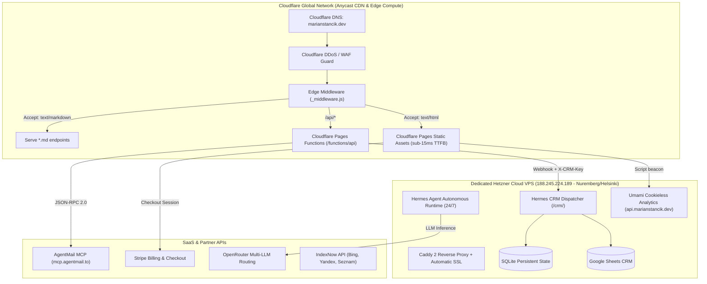

# marian-stancik-web — Personal Brand Website & Autonomous Engineering Hub

**Owner:** Marian Stancik  
**Version:** `v1.1.0` (Production Release — Cloudflare Edge & Hetzner Hybrid)  
**Domain:** https://marianstancik.dev (Production on Cloudflare Pages)  
**Apex & WWW Support:** https://marianstancik.dev & https://www.marianstancik.dev  
**Cloudflare Pages Project:** `marian-stancik` (`marian-stancik.pages.dev`)  
**Repo:** https://github.com/Abra7abra7/marian_stancik_dev_web  
**Backend VPS:** `188.245.224.189` (Hetzner Cloud — Caddy + Python WSGI + Hermes Agent + Umami)  
**Default Branch:** `main` (Single-branch trunk-based GitOps)

---

## 1. Executive Overview & Mission

This repository represents the official personal brand website, technical knowledge graph, and autonomous agent hub for **Marian Stancik** — AI Agent Developer & Autonomous Systems Builder.

The platform operates at the convergence of three foundational pillars:
1. **AI Engineering & Autonomous Multi-Agent Systems:** 24/7 Hermes Agent orchestration, custom Model Context Protocol (MCP) servers, OpenRouter multi-LLM dynamic routing, and an Obsidian persistent memory layer running on dedicated European Hetzner Cloud infrastructure.
2. **Law, EU AI Act & Regulatory Governance (Legal-by-Design):** Practical compliance architectures covering the EU AI Act (risk tiering, GPAI, technical files, Art. 50 disclosure), GDPR (Art. 7(3) opt-out), NIS2 Directive, DORA, EU Data Act, and statutory consumer protection (Act No. 108/2024 Coll. & Act No. 452/2021 Coll.).
3. **Tactical UAV Systems & Edge Robotics (Hobby Project):** Hand-soldered 1500g carbon quadcopter, ArduPilot Copter autopilot, Raspberry Pi 5 onboard companion computer with real-time edge vision AI, certified EASA A1/A3 with €2.6M Coverdrone insurance.

---

## 2. IDENTITY & ANONYMIZATION RULES (CRITICAL — ZERO TOLERANCE)

> [!CAUTION]
> **Delta Defence is NEVER mentioned by name anywhere on the web, code, blog, schema, or LLM graphs.**  
> Strict security and confidentiality requirement. Only `"Defence Product Manager"` and `"Defence Industry"` are permitted.

- ✅ Hero: `"Defence Product Manager"` / `"AI Agent Developer"`
- ✅ About: `"Defence Product Manager"`
- ✅ JSON-LD: `"name": "Defence Industry (confidential)"`
- ✅ Slovak: `"Defence Product Manager"`
- ✅ `llms.txt`, `llms-full.txt`, blog articles, AUDIT.md, and all HTML files: **ZERO occurrences** of the company name.
- 🛡️ Verified automatically via **L1 Security Sweep** in `scripts/verify_site.py`.

### Name & Visual Identity Standards
- **Name Standard:** Always **Marian Stancik** (strictly without diacritics) in both English and Slovak texts, schemas, metadata, and code.
- **Social / OG Image Standard:** All pages and articles must use Marian's photo (`https://www.marianstancik.dev/profile-big.webp` or `profile.webp`) as `og:image` and `twitter:image` with `width="800" height="800"` and `alt="Marian Stancik"`.
- **Search Snippet & Favicon Standard:** Circular portrait favicon with high-contrast bronze ring border generated from `profile.webp` via `scripts/generate_favicon.py` across all standard resolutions (`favicon.ico`, `favicon-32x32.png`, `favicon-48x48.png`, `apple-touch-icon.png`).

---

## 3. Infrastructure & Hosting Architecture (Cloudflare + Hetzner Hybrid)

The architecture is a modern, high-performance hybrid deployment combining a global edge CDN with a dedicated sovereign European VPS:



### Hosting Environments
1. **Frontend & Edge Hosting (Cloudflare Pages):**
   * **Project Name:** `marian-stancik` (`marian-stancik.pages.dev`).
   * **Custom Domains:** `marianstancik.dev` (Apex) and `www.marianstancik.dev` (CNAME), with full Google Trust Services SSL encryption.
   * **Edge Datacenters:** Closest European Anycast nodes (Vienna `VIE`, Frankfurt `FRA`) ensuring sub-15ms TTFB, 0ms Total Blocking Time (TBT), and 0 Cumulative Layout Shift (CLS).
   * **Headers & Security:** Configured via `_headers` (HSTS preload, Strict CSP, Permissions-Policy, Cache-Control, Vary headers).
   * **Redirects:** Configured via `_redirects` (legacy bot redirects, canonical rewrites, `/subscribe -> /#leadForm`).
2. **Serverless Edge Functions (Cloudflare Pages Functions):**
   * Located in `functions/api/`:
     * `functions/api/subscribe.js`: Lead capture, honeypot protection, customer confirmation dispatch, admin alert, CRM webhook sync.
     * `functions/api/crm-email.js`: Direct CRM email webhook dispatcher with `x-crm-key` token guard.
     * `functions/api/invoice/[id].js`: Secure HTTPS proxy to backend VPS with `noindex, no-store` headers.
     * `functions/api/email-templates.js`: Unified Bronze Neural HTML email templates with statutory GDPR Art. 7(3) and § 116 Act No. 452/2021 Coll. unsubscribe mechanism.
   * Located in `functions/_middleware.js`:
     * Intercepts `Accept: text/markdown` headers from AI crawlers and routes directly to `.md` alternates.
3. **Backend VPS (Hetzner Cloud — Germany/Finland):**
   * **IP Address:** `188.245.224.189` (`api.marianstancik.dev`).
   * **Caddy Reverse Proxy:** Reverse proxies internal WSGI/Python services, handles SSL termination via Let's Encrypt / ZeroSSL.
   * **Hermes Agent Runtime:** 19+ 24/7 background cron loops handling content publishing, social syndication, sentinel monitoring, and CRM sync.
   * **Hermes CRM Dispatcher:** Receives webhooks at `https://api.marianstancik.dev/crm/`, writes leads to SQLite and Google Sheets.
   * **Cookieless Umami Analytics:** Self-hosted European instance at `https://api.marianstancik.dev/script.js` (Website ID: `ec1c0df8-e51f-4236-9ad0-e3992f0b1637`).

---

## 4. Comprehensive Services & External Integrations Matrix

| Service / Tool | Role / Purpose | Protocol / Auth | Hosting / Region | Fallback / Resilience |
| :--- | :--- | :--- | :--- | :--- |
| **Cloudflare Pages** | Static asset delivery, Edge CDN, caching | HTTPS / Edge Cache | Global Anycast (VIE/FRA) | Automatic edge failover, 100% uptime SLA |
| **Cloudflare Functions** | Serverless API backend (`/api/subscribe`, `/api/crm-email`) | Edge V8 Workers | Global Anycast | Sub-10ms cold start, automatic retry |
| **Hetzner Cloud VPS** | 24/7 Hermes runtime, CRM service, Umami analytics | HTTPS / SSH / Caddy | Germany (Nuremberg) / Finland | Automated daily snapshots, systemd watchdogs |
| **AgentMail MCP** | Transactional & notification email sending without SMTP | JSON-RPC 2.0 (`mcp.agentmail.to`) | Cloud API (`x-api-key`) | Session init retry + admin alert failover |
| **Stripe** | Payment processing for 7 audits, deposits & subscriptions | Stripe Checkout Links | Global / EU compliant | Statutory waiver modal before redirect |
| **OpenRouter** | Multi-LLM dynamic routing (DeepSeek, Claude 3.5, GPT-4o) | REST API (`Bearer ${key}`) | US/EU multi-provider | Automatic model failover in Hermes Agent |
| **Umami Analytics** | GDPR-compliant, cookieless traffic analytics | Lightweight JS Beacon | Hetzner VPS (`api.marianstancik.dev`) | No cookies, no banner needed, zero tracking cookies |
| **OpenSEO MCP** | Automated SEO audits, keyword research, gap analysis | MCP JSON-RPC (`app.openseo.so`) | Cloud MCP Server | Local CLI tools & scripts |
| **IndexNow** | Instant search index pinging (Bing, Yandex, Seznam) | REST HTTP POST | Search engine endpoints | Asynchronous ping during `publish_post.py` |
| **Google Sheets & SQLite** | Double-entry CRM storage for leads and orders | Webhook JSON / SQLite | Hetzner VPS + Google Drive API | Fallback `[CRM DOWN]` emergency email alert |

---

## 5. What the Website Does & Core Features

1. **Autonomous Personal Brand & Portfolio:** Showcases Marian's work across autonomous AI agent architectures, regulatory governance (EU AI Act, GDPR), and tactical hardware engineering (ArduPilot UAV).
2. **Product Catalog & Instant Stripe Checkout:**
   * **4 One-Time Audits & Builds:**
     * *AI GEO Audit* (€199): 48h evaluation of AI search visibility (llms.txt, JSON-LD, robots.txt, Perplexity/ChatGPT presence).
     * *AI Web Readiness Scan* (€200): Technical compliance check covering GDPR Privacy Policy, consent, Terms, AI Act disclosures.
     * *Full Web Audit* (€300): Combined GEO + Readiness scan with 30-min strategy call.
     * *Custom Autonomous AI Agent* (From €500 deposit): Custom 24/7 autonomous agent system on dedicated VPS with MCP tooling.
   * **3 Monthly Recurring Subscriptions:**
     * *GEO Monitoring Weekly* (€49/mo): Automated weekly scans & alert reports.
     * *Sentinel Agent 24/7* (€99/mo): Continuous uptime, security & crawler monitor.
     * *Autonomous Ops Retainer* (€249/mo): Managed agent operations & custom tool extensions.
3. **Autonomous Technical Blog:**
   * 18 technical essays on production agent infrastructure, enterprise AgenticOps, MCP, and AI governance.
   * Multi-language parity: 72 synchronized articles (all 18 available in `EN`, `SK`, `DE`, `PL` both as `.html` and `.md`).
   * Interactive inline newsletter subscription card right inside each post with instant AJAX feedback.
4. **Lead Capture & Customer Onboarding:**
   * High-conversion homepage form + in-article forms submitting to `/api/subscribe`.
   * Automated double-send: instant branded HTML confirmation to client + instant alert to Marian.
   * Real-time sync into CRM via Hetzner VPS webhook.

---

## 6. Centralized Configuration & 4-Language i18n Matrix (`EN`, `SK`, `DE`, `PL`)

All site metadata, product definitions, Stripe pricing, social handles, and multilingual dictionaries are managed centrally:

```
├── site.config.json            # Central Single Source of Truth
├── locales/
│   ├── en.json                 # English (Primary International)
│   ├── sk.json                 # Slovak (Native Domestic)
│   ├── de.json                 # German (DACH Market)
│   └── pl.json                 # Polish (CEE Market)
└── js/i18n.js                  # Zero-build High-Performance i18n Client Engine
```

### i18n Routing & DOM Conventions
1. **Dynamic DOM Translation:** Any element with `id="KEY"` or `data-i18n="KEY"` automatically receives translated text or HTML from `locales/*.json` via `js/i18n.js`.
2. **Intelligent URL Subpage Router:**
   * When on `/services` and clicking `SK` → automatically navigates to `/services-sk`.
   * When on `/services-sk` and clicking `EN`, `DE`, or `PL` → automatically navigates to `/services`.
   * Similarly for paired legal subpages: `/privacy` <-> `/privacy-sk`, `/terms` <-> `/terms-sk`, `/disclaimer` <-> `/disclaimer-sk`.
   * In blog articles: clicking language buttons routes cleanly between `/blog/posts/{slug}`, `/blog/posts/sk/{slug}`, `/blog/posts/de/{slug}`, and `/blog/posts/pl/{slug}`.
3. **Dynamic Navigation Link Rewriting:**
   * When `currentLang === 'sk'`, navigation links (`#navProducts`, `#navServices`, `.home-prod-card`) dynamically point to `/services-sk`.
   * When `currentLang !== 'sk'`, they point to `/services`.
4. **Client-Side Event Bus:** Language switching triggers a `languageChanged` custom DOM event and stores preference in `localStorage.getItem('ms_lang')`.

---

## 7. Repository Structure & File Topology

```
.
├── .agents/
│   ├── mcp_config.json         # OpenSEO MCP Server Integration (Bearer ${OPENSEO_API_KEY})
│   └── skills/                 # OpenSEO Agent Skills (seo-audit, keyword-research, etc.)
│
├── _headers                    # Cloudflare Pages HTTP Security Headers (HSTS, CSP, Vary)
├── _redirects                  # Cloudflare Pages Edge Redirects (/subscribe -> /#leadForm)
│
├── index.html                  # Homepage (Hero, Products, About, Dynamic Blog, Lead Form)
├── about.html                  # About Marian Stancik + Hermes Cockpit + Timeline
├── services.html               # 4 AI Products + 3 Subscriptions (EN/DE/PL) + Stripe Modals
├── services-sk.html            # 4 AI Produkty + 3 Predplatné (SK) + Stripe Modals & Waiver
├── skills.html                 # AI & Engineering Capabilities
├── expertise.html              # Core Focus & Domain Architecture
├── drones.html                 # Tactical UAV & Edge Robotics (Hobby Project)
├── contact.html                # Contact Hub & Direct Booking Inquiry
├── cookie.html                 # Cookie Policy (Cookieless Architecture Documentation)
├── impressum.html              # Impressum & Business Identification
├── privacy.html / privacy-sk   # GDPR & Data Privacy Documentation (EN / SK)
├── terms.html / terms-sk       # Terms of Service (EN / SK)
├── disclaimer.html / -sk.html  # EU AI Act Art. 50 Disclaimers (EN / SK)
│
├── functions/                  # Cloudflare Pages Serverless Edge Functions
│   ├── _middleware.js          # AI Content Negotiation (Accept: text/markdown -> .md)
│   └── api/
│       ├── subscribe.js        # Lead Capture -> AgentMail MCP + Hetzner CRM Webhook
│       ├── crm-email.js        # Hermes CRM Dispatcher (Protected via CRM_WEBHOOK_KEY)
│       ├── email-templates.js  # Branded HTML email templates with GDPR unsubscribe link
│       └── invoice/[id].js     # HTTPS Invoice Proxy -> api.marianstancik.dev
│
├── api/                        # Legacy / Node / Vercel fallback function mirror
│   ├── subscribe.js
│   ├── crm-email.js
│   ├── email-templates.js
│   └── invoice/[id].js
│
├── blog/
│   ├── index.html              # Blog Archive with Instant 4-Language Switcher
│   ├── posts.json              # Synchronized Article Metadata in 4 Languages
│   └── posts/
│       ├── *.html & *.md       # 18 Standalone English Articles + Markdown Alternates
│       ├── sk/*.html & *.md    # 18 Standalone Slovak Articles + Markdown Alternates
│       ├── de/*.html & *.md    # 18 Standalone German Articles + Markdown Alternates
│       └── pl/*.html & *.md    # 18 Standalone Polish Articles + Markdown Alternates
│
├── css/
│   └── main.css                # Bronze Neural Design Tokens, Responsive Grid & Components
├── js/
│   ├── i18n.js                 # Centralized 4-Language Translation & URL Router
│   └── three-bg.js             # High-Performance Vanilla Three.js Neural Web Background
│
└── scripts/
    ├── publish_post.py         # Autonomous Blog Generator (4 Languages + IndexNow + Sitemap)
    ├── sync_site.py            # Site Config Sync Engine (sitemap.xml, llms.txt, alternates)
    ├── generate_missing_md.py  # Markdown Alternates Generator for all 4 languages
    ├── verify_site.py          # 9-Tier Automated Production Verification Suite
    └── test_all_channels.py    # Live API & Channel Integration Test Script
```

---

## 8. Generative Engine Optimization (GEO), Technical SEO & OpenSEO Suite

To guarantee instant, authoritative discovery and citations across AI engines (**Perplexity, ChatGPT Search, Claude, Google SGE, Grok**) as well as standard search engines:

### Core Web Vitals & Technical SEO Benchmarks
1. **100/100 Core Web Vitals:** Mobile & Desktop performance (sub-15ms TTFB, LCP < 400ms, CLS = 0). Zero render-blocking resources, externalized minified CSS/JS, and asynchronous Three.js canvas.
2. **Canonical URLs & Single-Hop Redirects:** All internal and sitemap links strictly omit trailing slashes (e.g., `/blog` instead of `/blog/`). All legacy/bot paths (e.g., `/lead-magnet/*`) and `/subscribe` are redirected in a single hop via `_redirects`.
3. **SERP Snippet Standards:**
   * `<title>`: 50–60 characters (max 60 chars to prevent truncation in Google SERP).
   * `<meta name="description">`: 140–155 characters (optimized for desktop and mobile viewports).
   * Synced parity across `og:title`, `og:description`, `twitter:title`, `twitter:description`.

### AI Discovery & LLMO Blueprint
1. **`llms.txt` & `llms-full.txt` (llmstxt.org v2 Standard):** Clean Markdown links with summaries of all articles, products, and pages.
2. **4-Language Markdown Alternates & Content Negotiation:** Every HTML page and blog post provides a clean markdown version (`*.md`). `functions/_middleware.js` intercepts requests with `Accept: text/markdown` and transparently routes AI agents directly to `.md` endpoints (`Vary: Accept`).
3. **AI Crawler White-Listing & Content-Signals (`robots.txt`):** Explicitly grants access to GPTBot, ChatGPT-User, ClaudeBot, PerplexityBot, Google-Extended, Applebot-Extended, CCBot, Bravebot, Meta-ExternalAgent, Cohere-ai, Diffbot, and OAI-SearchBot while defining modern content licensing signals:
   ```text
   Content-Signal: ai-train=no, search=yes, ai-input=yes
   ```
4. **Schema.org JSON-LD Hierarchy:** Rich `@graph` containing `Person`, `Organization`, `WebSite`, `Service`, `Offer`, and `FAQPage` schemas with precise pricing (€199, €200, €300, €500).

---

## 9. Lead Capture, Newsletter Lifecycle & Legal Compliance

```mermaid
flowchart LR
    Visitor[Client Web Form] -->|POST /api/subscribe| EdgeFunction[Cloudflare Pages Function]
    EdgeFunction -->|Honeypot Check| SpamDrop[Silently drop bots]
    EdgeFunction -->|JSON-RPC 2.0| AgentMail[mcp.agentmail.to]
    AgentMail -->|Branded HTML + Unsubscribe| CustomerInbox[Customer Inbox]
    AgentMail -->|Instant Alert| MarianInbox[marianstancik@agentmail.to]
    EdgeFunction -->|POST /crm/ Webhook| HetznerCRM[api.marianstancik.dev]
    HetznerCRM -->|Storage| Sheets[(Google Sheets + SQLite)]
    EdgeFunction -.->|Failover Alert| DownAlert["[CRM DOWN] Alert Email"]
```

### Statutory Compliance & Consumer Protection
1. **Statutory Digital Content Waiver (§ 19 Act No. 108/2024 Coll.):**
   * Before redirecting to Stripe, clients purchasing digital audits must confirm:
     > *"I explicitly consent to the commencement of digital service provision before the expiry of the statutory 14-day withdrawal period, and I acknowledge that by granting this consent, I lose the right of withdrawal under § 19 of Act No. 108/2024 Coll. once the service is fully provided."*
2. **Statutory Unsubscribe & Consent Withdrawal (GDPR Art. 7(3) & § 116 Act No. 452/2021 Coll.):**
   * Every outgoing email generated by `functions/api/email-templates.js` contains full sender identification (Marián Stančík, IČO: 57068917, DIČ: 1082585075), Art. 50 AI disclosure, and a direct, free, one-click opt-out link:
     > *"Tento e-mail ste dostali na základe udeleného súhlasu na marianstancik.dev. Odber môžete kedykoľvek bezplatne zrušiť: [Odhlásiť sa z odberu](mailto:marianstancik@agentmail.to?subject=Unsubscribe%20Newsletter)."*
3. **Cookieless EU Privacy Architecture:**
   * 100% cookieless analytics via self-hosted Umami on European infrastructure (`api.marianstancik.dev`).
   * Zero third-party cookies, no tracking pixels, fully compliant with GDPR Art. 6(1)(f) and the ePrivacy Directive without intrusive cookie consent banners.

---

## 10. Automated Verification Suite (`scripts/verify_site.py`)

Run the 9-tier verification script before any deployment:
```bash
python scripts/verify_site.py
```

### Test Tiers
1. **Tier 1 — Security & Anonymization Sweep (L4):** Regex scan ensuring zero occurrences of forbidden company names.
2. **Tier 2 — JS Syntax Check (L0):** `node --check js/i18n.js` and `node --check js/three-bg.js`.
3. **Tier 3 — HTML Meta & Link Integrity:** Validates root-relative links, OpenGraph tags, and JSON-LD syntax across all pages.
4. **Tier 4 — Design Tokens & CSS Validation:** Checks `:root` token presence in `css/main.css`.
5. **Tier 5 — AI Discovery & GEO:** Validates `<link rel="alternate" href="/llms.txt">` and AI crawler permissions in `robots.txt`.
6. **Tier 6 — API Health Check (L8):** Validates live HTTP 200 response from `/api/subscribe`.
7. **Tier 7 — Config, Locales & Markdown Integrity:** Validates `site.config.json`, all 4 `locales/*.json` files, and guarantees 72/72 `.html` and `.md` blog alternates.
8. **Tier 8 — 4-Language Parity Check:** Verifies 100% dictionary key parity across `en.json`, `sk.json`, `de.json`, and `pl.json`.
9. **Tier 9 — Deploy Safety Check:** Verifies no unwanted output directories before deploying.

---

## 11. GitOps & Release Procedures

- **Branching Model:** Trunk-based GitOps on `main`.
- **Production Tag:** `v1.1.0`
- **Cloudflare Deployment Command:**
  ```powershell
  $env:CLOUDFLARE_API_TOKEN="<cf_token>"; $env:CLOUDFLARE_ACCOUNT_ID="<cf_account_id>"; npx wrangler pages deploy . --project-name=marian-stancik --branch=main --commit-message="Deploy update"
  ```
- **Git Push Trigger:** Every push to GitHub `main` synchronizes trunk-based changes and keeps remote repository in lockstep with Cloudflare Pages edge.